# Each stage of the ns-3 TcpBbrV3 port against Linux BBRv3

Figures comparing the six stages of the port (one commit each in this repo's
history, see `../README.md`) with the Linux kernel,
on Pedro's 36-config grid. Everything here is measured data: the per-flow
goodput of every Linux run and every ns-3 run. There is no BBR or TCP code in
this folder; the Python script only computes the comparison measures and
draws them.

```
pip install matplotlib
python3 make_figures.py          # rewrites figures/
```

## The data

- **Grid:** 50 / 100 / 500 Mb/s x 5 / 25 / 100 ms RTT x 0.1 / 1 / 2 / 4 BDP
  buffer. Two BBRv3 flows; the second joins at 12 s; 45 s per flow; MSS 1448.
  Config names are `rate/RTT/buffer`.
- **Linux:** kernel 6.13.7 with Google's BBRv3, run with nsperf on Google
  Cloud. Three complete grid runs.
- **ns-3:** each stage run with RngRun seeds 1, 2 and 3. Stages 4 and 6 also
  with seeds 4, 5 and 6 (figure 13).
- **Earlier versions:** the Aug 31, Oct 21 and Nov 10 versions of the port,
  rebuilt and run on Nov 17 through the same harness and measure, seeds 1-3
  (figure 12 and the slides). See "Earlier versions" below.
- **Goodput:** cumulative-ACK progress at the sender, in 0.1 s bins, measured
  the same way on both sides (`data/goodput_bins.csv.gz`; `tools/` rebuilds it
  from the raw results).

## The measures

- **Bad bin:** a 0.1 s bin in 15-45 s (both flows running) in which a flow gets
  less than half its own median goodput. This is the probing drop-off.
- **Stall:** 3 or more bad bins in a row (300 ms or longer).
- **Distance:** |bad-bin % of an ns-3 run - bad-bin % of a Linux run| for the
  same config. Every ns-3 seed is compared with every Linux run, and the result
  is averaged over configs.
- **Linux vs Linux:** the same distance between Linux's own runs. This is the
  noise floor: closer than this cannot be told apart from Linux.

## The stages

| Stage | Adds |
|---|---|
| 1 | the Nov 11 upload |
| 2 | inflight bounds in whole segments; TSO-sized bursts at skb boundaries |
| 3 | TSO deferral (`tcp_tso_should_defer()`) |
| 4 | ACK-aggregation cwnd in STARTUP |
| 5 | inflight at the next departure time; cwnd-limited tracked per window |
| 6 | inflight_hi growth floor; pacing catch-up credit (final) |

## Earlier versions

| Version | Source | Run with |
|---|---|---|
| Aug 31 | the first port, on upstream ns-3 `7db999bf9` | draft-06 gains (the port had no gain attributes), standard ns-3 RTO |
| Oct 21 | this repo at `548a189f0` (probing fixes) | draft-06 gains, standard ns-3 RTO |
| Nov 10 | this repo at `5371dfa` (draft-06 defaults, ACK-aggregation epoch fix) | Linux gains, standard ns-3 RTO |

Each was built with the comparison harness of today (its BBR state logging
removed, since the old versions do not export that state), with the netem-style
queue and the same goodput measure. None of them has `LinuxRto`, which arrived
with stage 1. Aug 31 and Oct 21 cannot be given the Linux gains, so part of
their distance comes from the draft-06 gains rather than from bugs. The Aug 31
and Nov 10 results agree with the earlier measurements in `../FIX-LOG.md`
(3.3 pp and 2.39 pp / 69 stalls).

The Oct 21 version runs out of memory at 500/100/2 with seed 2: the simulation
grows past 15 GB (8 GB RAM + 8 GB swap) and is killed at 43.5 s simulated time.
It failed the same way when re-run alone, so it is a fault of that version.
That config is left out of the Oct 21 averages (35 configs instead of 36).

## Figures

### 1. Summary measures per stage
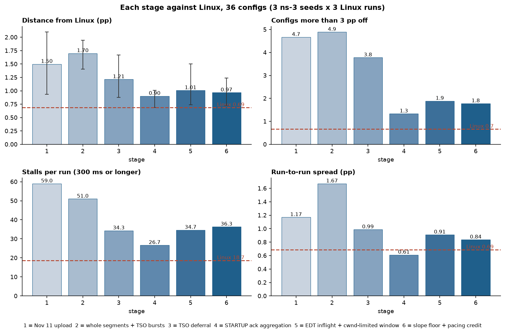
Distance, configs more than 3 pp off, stalls and run-to-run spread for each
stage. The dashed line is Linux against itself. Whiskers on the distance bars
are the best and worst of the 9 seed/kernel pairs.

### 2. Distance by buffer, RTT and rate
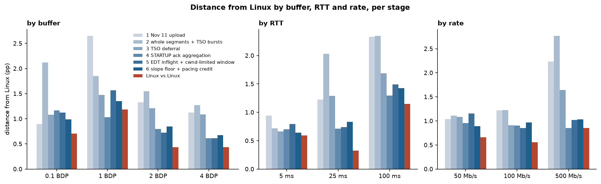
Where each stage gained or lost. Red bars: Linux against itself for that group.

### 3. Stalls by buffer, RTT and rate
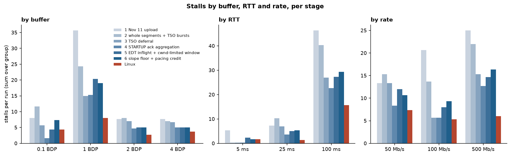
The 1 BDP and 100 ms groups hold most of the remaining excess stalls.

### 4. Every config, every stage
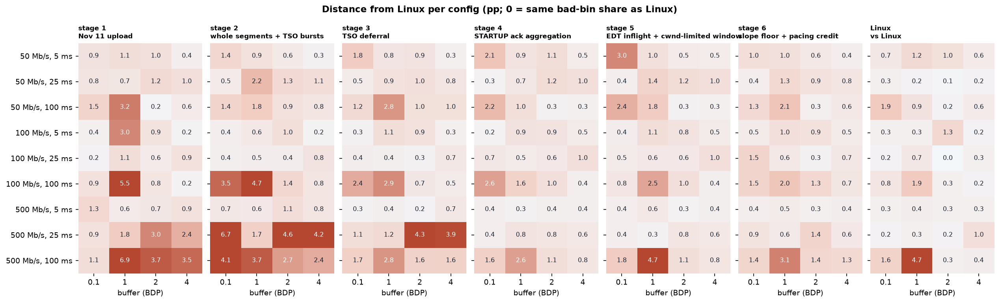
Distance from Linux for each config. The last panel is Linux against itself;
500/100/1 is noisy in Linux too.

### 5. Each config across the stages
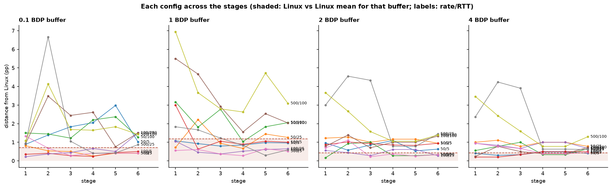
One line per config, one panel per buffer size. The shaded band is Linux's own
noise for that buffer.

### 6. What each stage changed
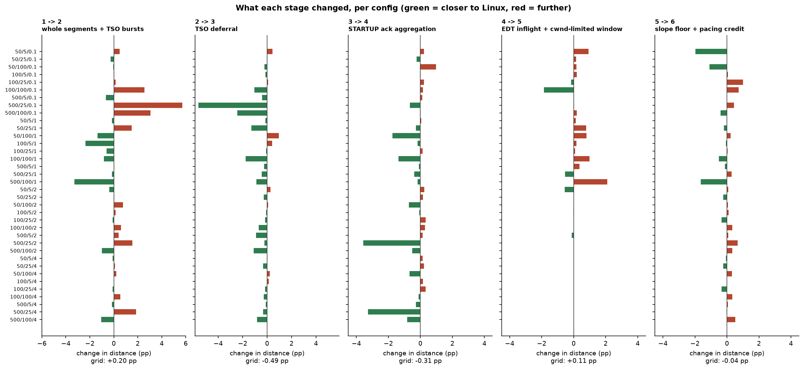
Per-config change in distance from one stage to the next: green moved closer
to Linux, red moved away. The grid-level change is under each panel.

### 7. ns-3 against Linux, config by config
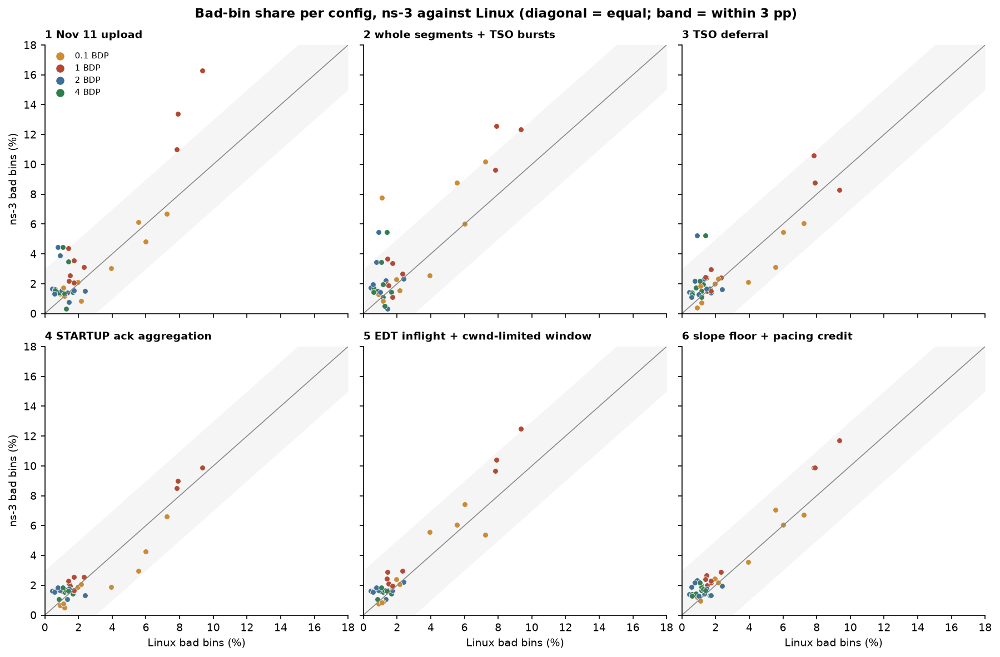
Bad-bin share of each config, Linux on x and ns-3 on y. On the diagonal = the
same as Linux; the band is within 3 pp.

### 8. Distribution over all runs
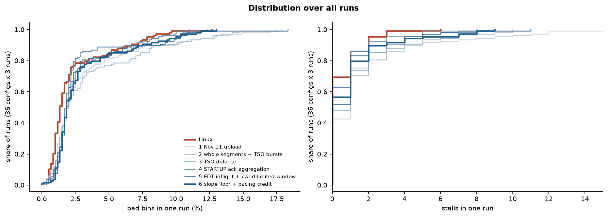
Bad bins and stalls of every single run (36 configs x 3 runs).

### 9. A/B of the two stage-5 changes
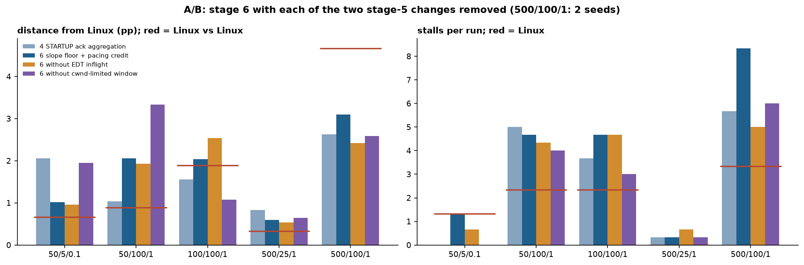
Stage 6 with each stage-5 change removed, 4 configs x 3 seeds (500/100/1:
2 seeds). Without the per-window cwnd-limited flag, 100/100/1 improves but
50/100/1 and 50/5/0.1 get worse, and the mean is worse (1.91 vs 1.76 pp).

### 10. Loss episodes at 500/25/1
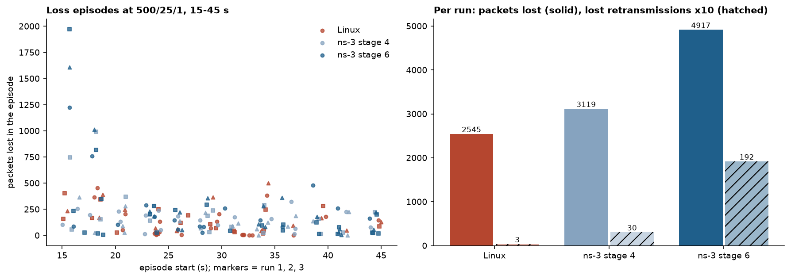
Linux from the sender pcap, ns-3 from the bottleneck drop log, both grouped
the same way (gaps over 50 ms). The large ns-3 episode at 15.7 s is the
PROBE_RTT / PROBE_UP overlap described in [`../FIX-LOG.md`](../FIX-LOG.md)
(`data/loss_episodes_500_25_1.csv`).

### 11. Goodput over time, Linux and each stage
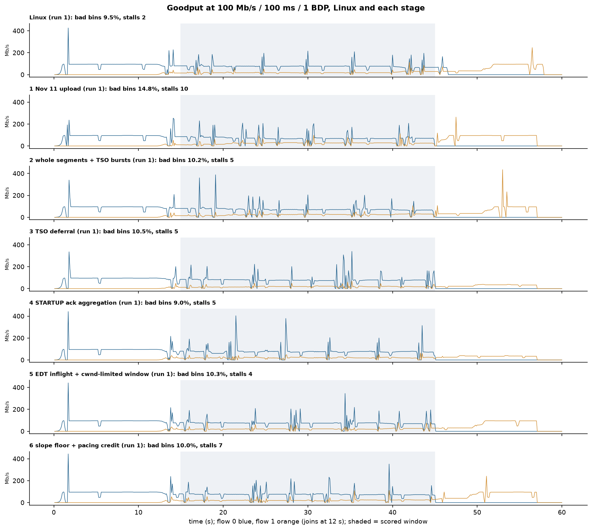
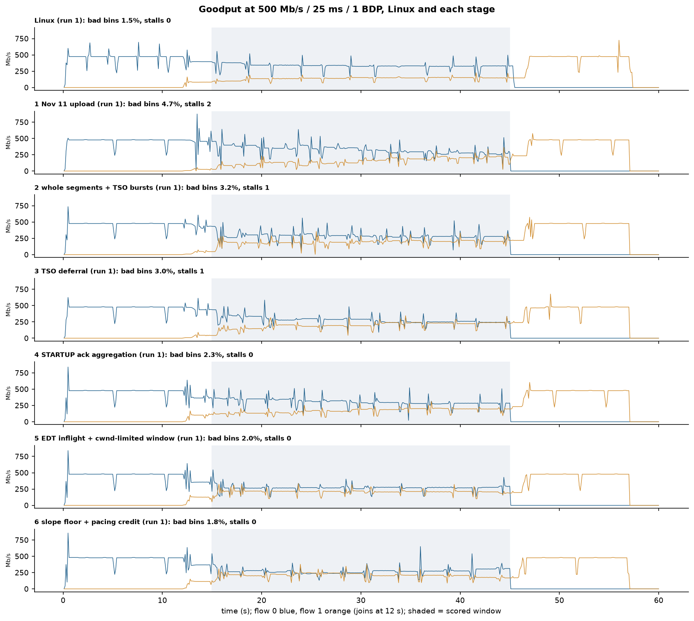
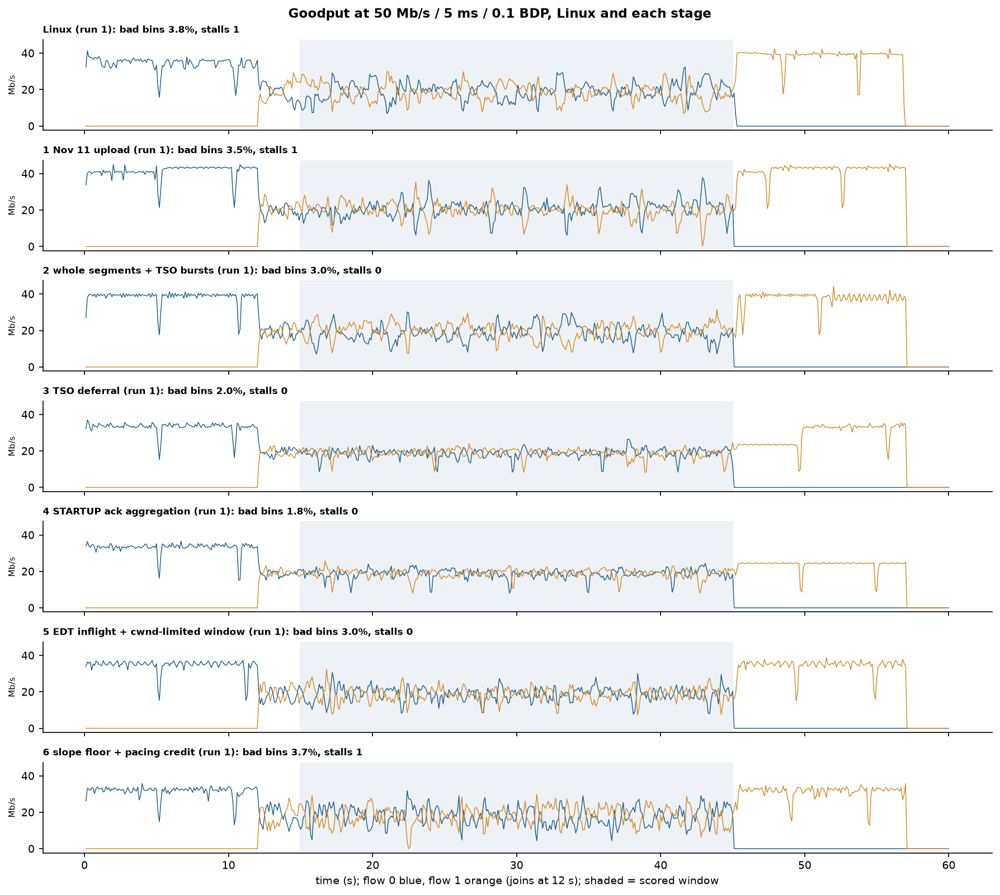
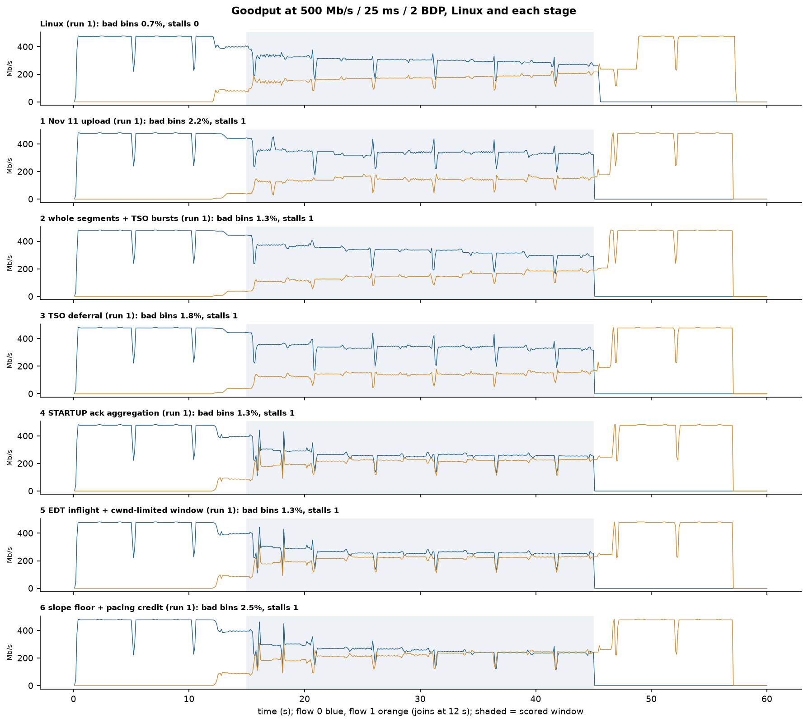
Run 1 of Linux and seed 1 of each stage. The shaded window is what is scored.

### 12. The port over time
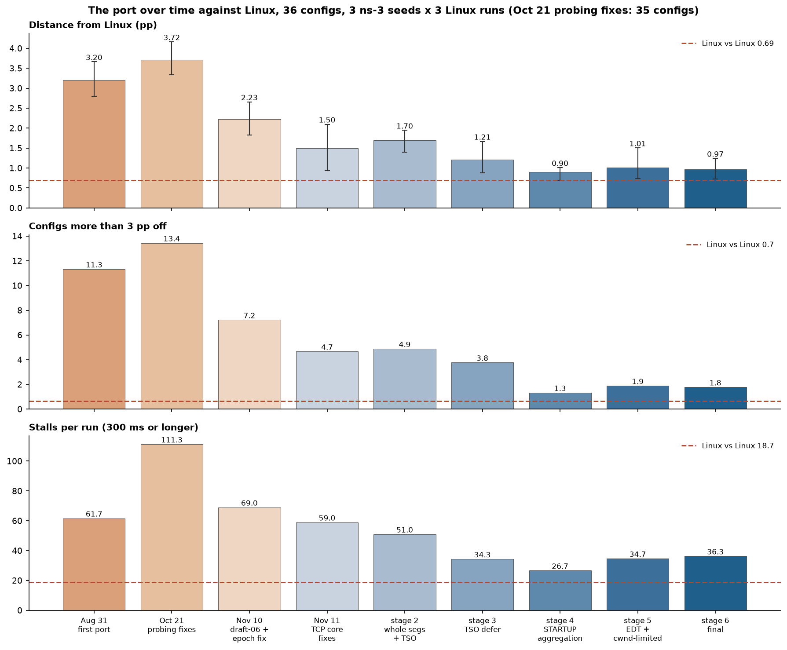
Every version from the first port to the final one, with the same measures as
figure 1. The Oct 21 probing changes made the grid worse as a whole (more
stalls) before the Nov 3-12 work brought it to within 0.3 pp of Linux's own
noise.

### 13. Stage 4 against stage 6, 6 seeds each
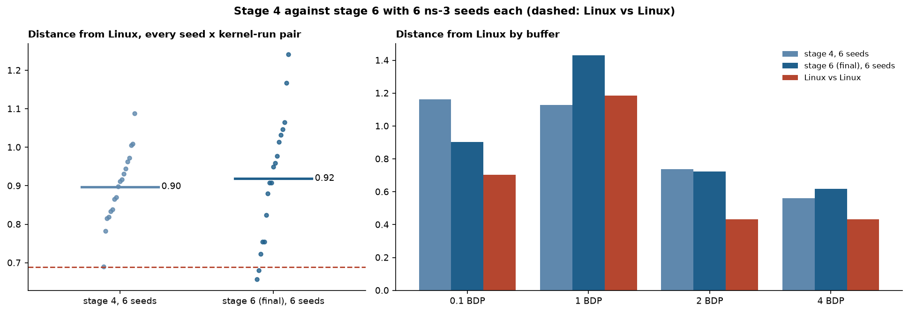
With 6 seeds each, stage 4 and stage 6 are equally close to Linux on distance
(0.90 vs 0.92 pp; the per-pair ranges overlap). Stage 6 is closer at 0.1 BDP,
which is what its fixes targeted, and further at 1 BDP, and it has more stalls
(35.5 vs 26.3 per run; Linux 18.7).

## Slides

`figures/slides/` has the presentation versions (16:9, large text):

| File | Shows |
|---|---|
| `s01_history_distance.png` | distance from Linux, every version |
| `s02_history_stalls.png` | stalls per run, every version |
| `s03_before_after_100_100_1.png` | goodput over time: Linux, the Aug 31 port (flow 1 starved after flow 2 joins) and the final port |
| `s03_before_after_500_25_0.1.png` | the same at 500/25/0.1, where the Aug 31 port oscillates |
| `s04_heatmap_before_after.png` | per-config distance: Aug 31, final, Linux vs Linux |
| `s05_stages_distance.png` | distance for the six Nov 11-12 stages only |

The bad-bin measure compares each flow with its own median, so a flow that is
starved for the whole window (the Aug 31 port at 100/100/1) shows few bad bins.
The slide titles therefore also give each flow's mean goodput in the window.

## Tables

- `figures/summary_by_stage.csv`: the grid-level measures per stage, per
  earlier version and for the 6-seed runs.
- `figures/per_config_by_stage.csv`: bad bins, distance and stalls per config
  per stage.
